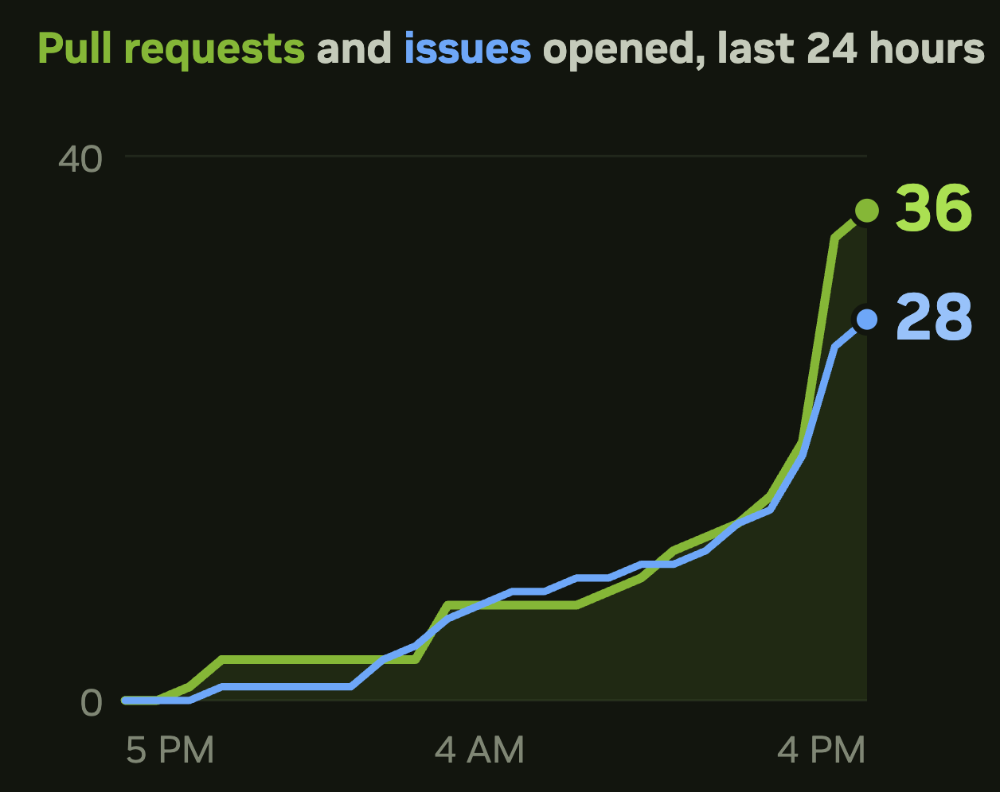
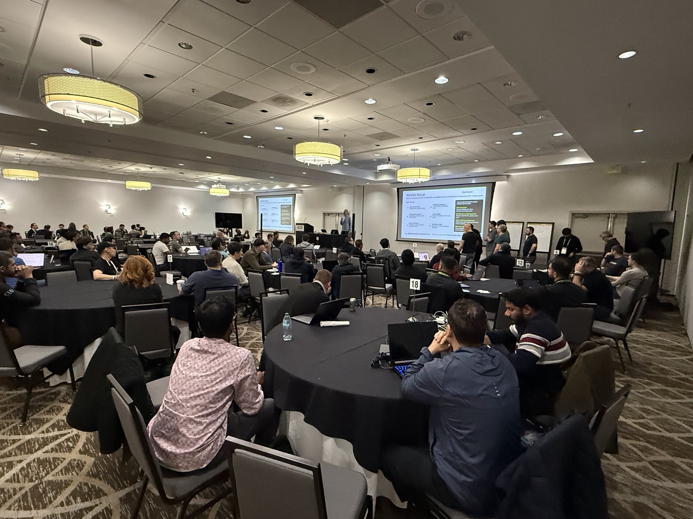
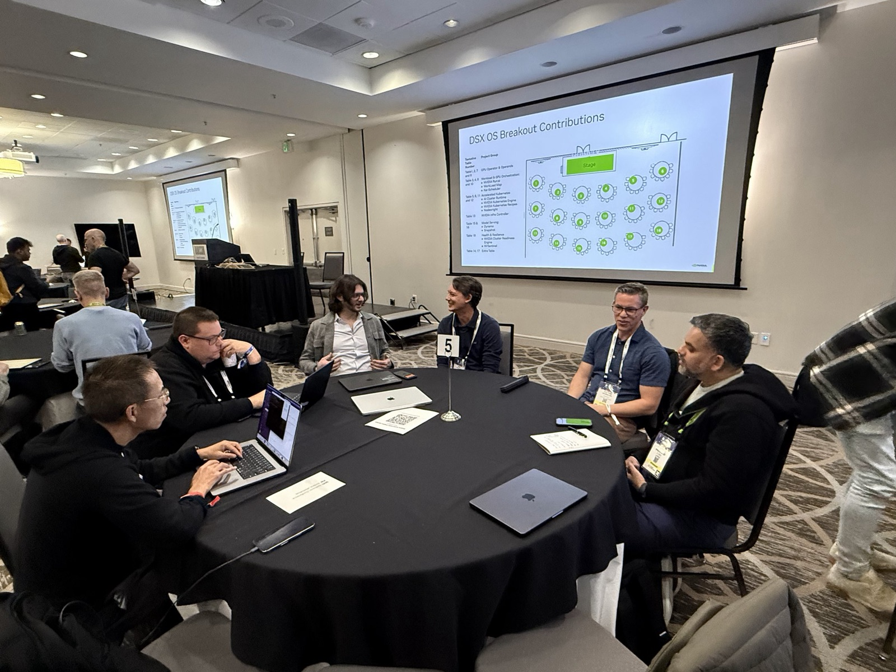
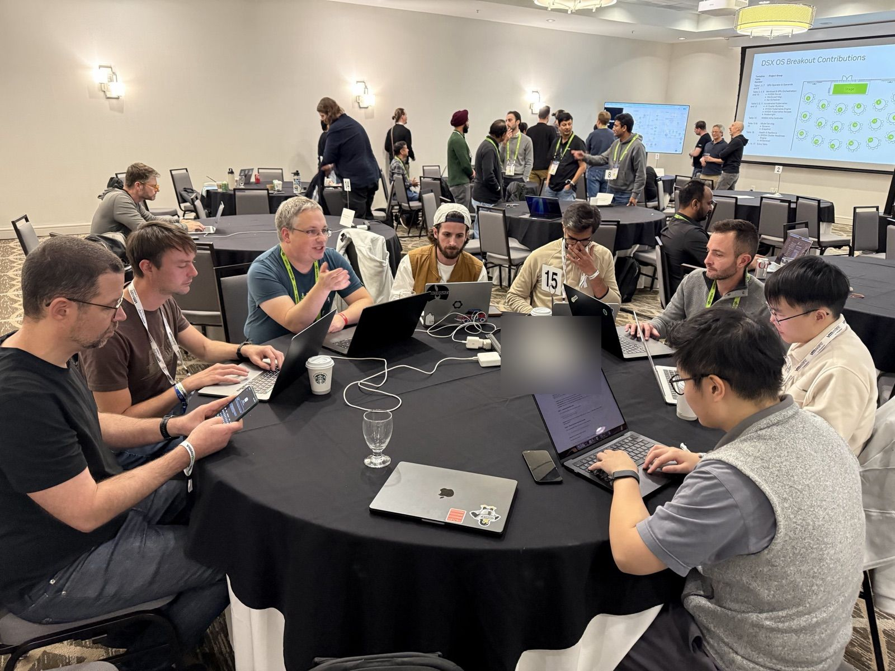
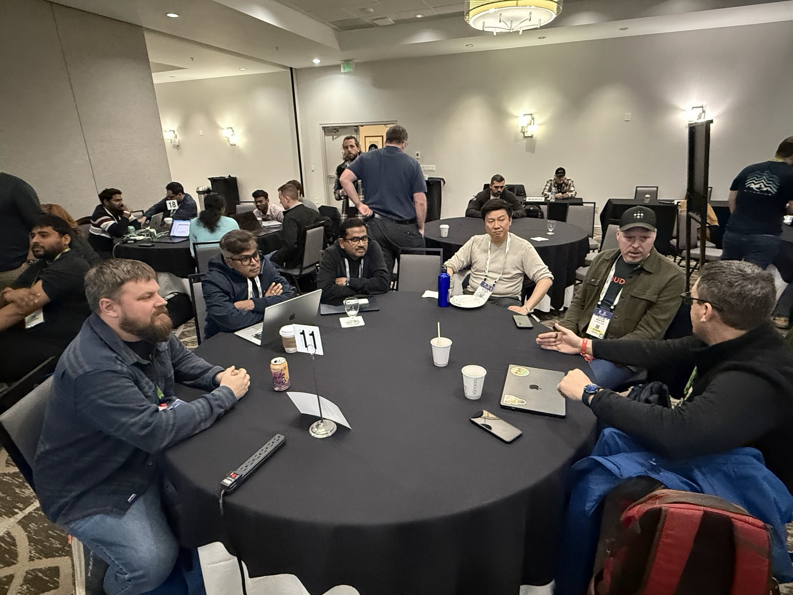
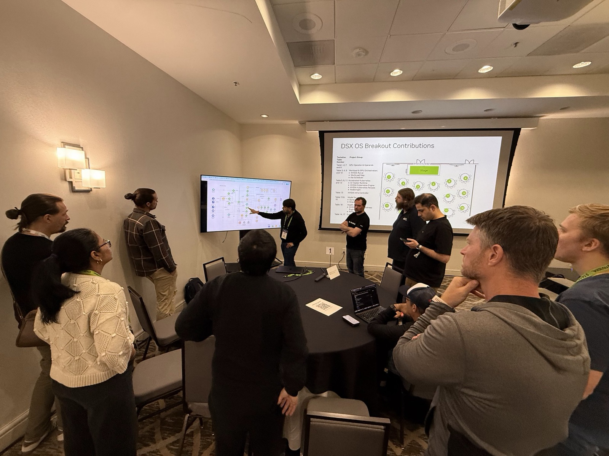
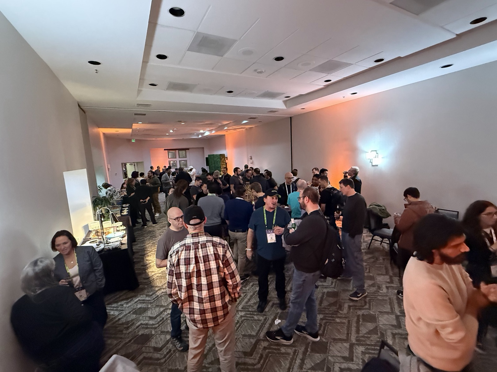
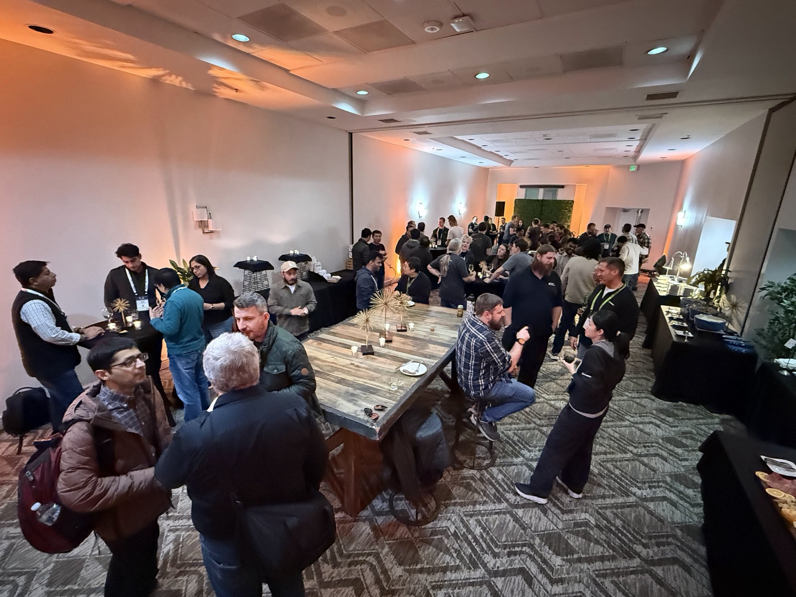
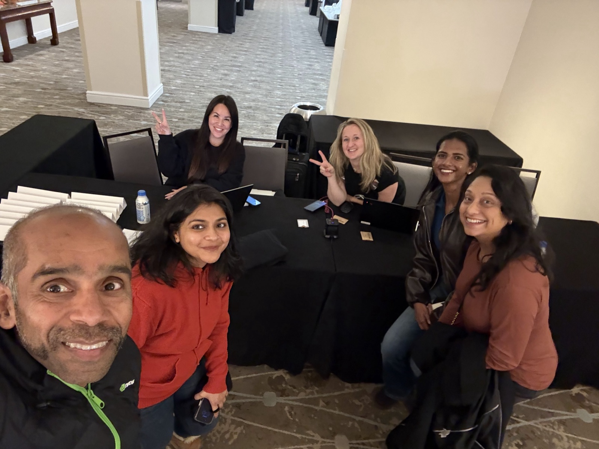

# People Over Code: A Contributor Workshop and a Maintainer Social at KubeCon North America

In the 24 hours around the DSX OS Contributor Workshop in Salt Lake City, 57 contributors across 12 repositories opened 36 pull requests and 28 issues and left 64 comments. Compared with a typical day over the previous 30 days:

- **Overall activity was up 59%.**
- **Pull requests were up 79%**, 36 against a typical 20.
- **First-time contributors were up nearly 4x**, 19 against a typical 5.

Four pull requests merged the same day, and 32 more were in review with maintainers. The hockey stick at the right edge of the chart below is the workshop afternoon, when contributors and maintainers worked side by side.

   
  <em>Pull requests and issues opened over 24 hours</em>

Most open source projects have the same quiet problem. People can see the issues, the code, and the contributing guide, and still don't contribute, because the distance between reading a repository and getting a first pull request merged is longer than it looks. You need a working environment, an understanding of the CI, and someone to ask when it breaks. Each of those takes minutes with a maintainer in the next chair and days alone, which is the idea behind the DSX OS Contributor Workshop: put the people who use a project in the same room as the people who build it, and spend the time on real issues instead of slides.

It rests on three ideas:

- **An explicit conversation with partners and customers about contributing.** "Contributions welcome" in a README is easy to ignore, and a maintainer saying "this issue is yours" across a table is not.
- **More participation from outside NVIDIA.** In Salt Lake City, that meant the cloud native community already in town for KubeCon.
- **Keeping the contributions going.** We measure it by who is still active 90 days later, not by pull requests opened on the day.

The [first workshop](https://www.linkedin.com/pulse/building-dsx-os-open-what-its-customers-partners-did-one-arun-gupta-iehsc/), an invite-only day at NVIDIA headquarters in September, showed what happens when the distance between a user and a maintainer disappears, and the second, which we [announced ahead of time](https://github.com/dsx-ai-factory/community/blob/main/articles/kubecon-2026-dsx-os-contributor-workshop.md), took the format to Salt Lake City on Monday, November 9, the day before KubeCon + CloudNativeCon North America opened. [Warren Barkley](https://www.linkedin.com/in/warrenbarkley/) opened with an introduction to DSX, every product manager gave a lightning introduction, and then people split into contribution sprints across six project groups:

- **GPU Operator and Operands:** [NVIDIA GPU Operator](https://github.com/NVIDIA/gpu-operator)
- **Workload and GPU Orchestration:** [NVIDIA Run:ai](https://github.com/dsx-ai-factory/run-ai), [Workload Map](https://github.com/dsx-ai-factory/workload-map), [KAI Scheduler](https://github.com/kai-scheduler/KAI-Scheduler)
- **Accelerated Kubernetes:** [NVIDIA AI Cluster Runtime](https://github.com/NVIDIA/aicr), [NVIDIA Kubernetes Engine](https://github.com/dsx-ai-factory/nvke), [NVIDIA Kubernetes Recipes](https://github.com/dsx-ai-factory/nvkr), [NVIDIA Nodewright](https://github.com/NVIDIA/nodewright)
- **Infrastructure:** [NVIDIA Infra Controller](https://github.com/dsx-ai-factory/infra-controller)
- **Model Serving:** [NVIDIA Dynamo](https://github.com/ai-dynamo/dynamo), [NVIDIA Snapshot](https://github.com/ai-dynamo/snapshot)
- **Health and Resilience:** [NVIDIA Cluster Readiness Engine](https://github.com/NVIDIA/cluster-readiness-engine), [NVSentinel](https://github.com/NVIDIA/NVSentinel)

Contributing meant more than code: you could discuss the roadmap, file an issue, give a maintainer feedback in person, or open a draft pull request and get a live review, and all of it counted.

   
  <em>A product manager gives a lightning introduction to the room.</em>

## What happened at the tables

Some teams spent contribution time on roadmap discussions and requirements, four project communities used the day to kick off regular community meetings, and others shipped code. See the [upcoming community meetings](https://github.com/dsx-ai-factory/community/blob/main/articles/dsx-ai-factory-community-meetings.md) to join one.

At the NVIDIA Kubernetes Recipes table, contributors opened four pull requests that are now all merged, two CLI fixes and two features, one filtering the recipe catalog by platform and output type. Two Workload Map contributors opened pull requests, one adding Argo Rollouts to the catalog and one fixing how Milvus etcd and MinIO pods are identified. On the NVIDIA Infra Controller table, one of the contributors filed a detailed issue about public IPs, NAT, and load balancers for tenant networks. At NVIDIA Dynamo, one contributor added a router queue wait metric that is now in review. At NVIDIA AI Cluster Runtime, one of the contributors filed a feature request and had a recipe change merged the same day. At NVSentinel, one contributor came with feature requests and filed three of them on GitHub after the workshop, and two newer contributors came to learn about the health and resilience products, with one sending a pull request afterward.

<table>
  <tr>
    <td align="center"> <em>Each project had its own table.</em></td>
    <td align="center"> <em>Contribution time, laptops open.</em></td>
  </tr>
  <tr>
    <td align="center"> <em>A conversation at one of the tables.</em></td>
    <td align="center"> <em>Walking through an architecture diagram.</em></td>
  </tr>
</table>

The people in the contributor sessions came from 40 organizations, and the mix mattered as much as the number. GPU cloud and infrastructure companies like Crusoe, Lambda, Rafay, and Mirantis worked alongside large technology companies such as Google, Microsoft, and Apple, enterprises including JPMorgan Chase, Charles Schwab, and Intercontinental Exchange, and cloud native companies like Upbound, Kubermatic, and Clastix. Community groups and universities joined them too, among them Cloud Native Texas, the University of Utah, and the University of Colorado Boulder.

In the survey afterward, 96% of respondents said the workshop was a good use of their time, and 44% said very much.

## The Maintainer Social

A workshop brings newcomers to our projects, but much of what we build depends on people already deep in the cloud native ecosystem, the maintainers of Kubernetes and the CNCF projects around it. So we invited a small group to a casual evening, with no keynotes and no pitches. The invitation was simple: we wanted to thank them for their work in the cloud native community and celebrate it, introduce them to the NVIDIA maintainers who do the work on our projects, and hear where their own projects overlap with ours and how we show up in the community.

Around 50 maintainers of cloud native projects and community leaders came from 18 organizations and spent the evening with NVIDIA product, engineering, and leadership, including [Warren Barkley](https://www.linkedin.com/in/warrenbarkley/) and [Bob Wise](https://www.linkedin.com/in/bobwise/). The room included members of the Kubernetes Steering Committee, a CNCF Technical Oversight Committee member, the SIG-Node co-chair, and maintainers of [OpenShell](https://blogs.nvidia.com/blog/open-source-openshell-infrastructure/), the project NVIDIA donated to the CNCF that week.

<table>
  <tr>
    <td align="center"> <em>The first DSX AI Factory Maintainer Social.</em></td>
    <td align="center"> <em>Conversations over the evening.</em></td>
  </tr>
</table>

One NVIDIA engineer wrote afterward that the invite list was spot on, with long-term maintainers who want to adopt NVIDIA software and can help us get more involved upstream. Another called it a well-organized event and said they had good conversations with people from various Kubernetes SIGs and several cloud native companies. I enjoyed bringing the external maintainers and NVIDIA maintainers together. It has always been people over code, because meaningful relationships are what make you more effective when you collaborate.

## Thank you

Thank you to the organizations that spent the day with us and the maintainers who joined the social. Thank you as well to all the NVIDIA product managers and engineers who got their repositories ready for contributions and worked diligently with the external contributors. My co-leads Shally Garg, Pavitar Thiara, and Shweta Sadashiv Barge shared the planning with me, and Tiffany Nadler and Crysta Kaufmann helped with execution.

   
  <em>The team behind the day</em>

## Get involved

There are three ways to take part:

- **GitHub:** explore [github.com/dsx-ai-factory](https://github.com/dsx-ai-factory) and pick a project.
- **Slack:** request an invite at [inviter.co/dsx-ai-factory](https://inviter.co/dsx-ai-factory) to talk with the maintainers.
- **Community meetings:** find a project community in the [communities](../communities/README.md) directory.

If you have ever worked around a bug instead of reporting it, pick a project and tell us what is missing.

---

© 2026 NVIDIA Corporation. All rights reserved. NVIDIA, the NVIDIA logo, and other NVIDIA product and service names are trademarks and/or registered trademarks of NVIDIA Corporation in the U.S. and other countries and regions. Other company, product, and service names may be trademarks of their respective owners.
