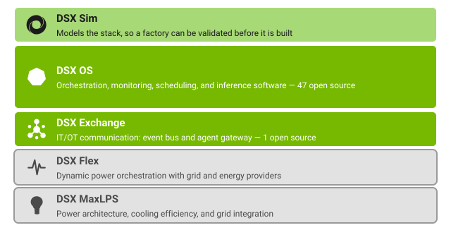

<!-- Generated by site/render_index.py from data/repos.txt. Do not edit by hand. -->

## What is DSX

DSX is NVIDIA's AI Factory platform: everything needed to plan, build, and run a
GPU-accelerated data center, from the physical site up through simulation. It runs in
five layers:

- **Facilities Infrastructure** covers the physical site: land, connectivity, power, and shell.
- **Hardware** is compute, network, and storage.
- **Software - Infrastructure** provisions and runs the cluster: cluster orchestration and provisioning, infrastructure management, monitoring and observability, resiliency and remediation, security, and core operations.
- **Software - Platform** is scheduling, workload management, and optimized inference, the layer that turns a provisioned cluster into one that serves workloads.
- **Simulation** models the other four layers, so an AI factory can be validated before it is built.

Most of DSX is not open source. The components below are the ones that are: DSX
components released as open source, plus the NVIDIA-org and upstream projects they
depend on, each shown against the DSX layer it occupies.

## DSX components released as open source, by layer

### Cluster Orchestration & Provisioning

- **[infra-controller](https://github.com/dsx-ai-factory/infra-controller)**: Hardware lifecycle management and multitenant networking (NiCo / Carbide). (Apache-2.0, open source, dsx-ai-factory)
- **[AICR (AI Cluster Runtime)](https://github.com/NVIDIA/aicr)**: Tooling for optimized, validated, and reproducible GPU-accelerated AI runtime in Kubernetes. (Apache-2.0, open source, NVIDIA org)
- **[DPF (DOCA Platform Framework)](https://github.com/NVIDIA/doca-platform)**: Manages provisioning and service orchestration for BlueField DPUs. (Apache-2.0, open source, NVIDIA org)
- **[NiCo REST (Infra Controller REST)](https://github.com/NVIDIA/infra-controller-rest)**: NVIDIA Infra Controller REST API. Public but archived; disposition (move, stay archived, or superseded) is an open question in the Org POR. (Apache-2.0, archived, NVIDIA org)
- **[Project Topograph](https://github.com/NVIDIA/topograph)**: Toolkit for discovering cluster network topology. Topology input to KAI Scheduler. (unknown, open source, NVIDIA org)
- **[FARM](https://github.com/NVIDIA/farm)**: Job scheduler for cloud-based workloads. Archived. (Apache-2.0, archived, NVIDIA org)
- **[Nodewright (Project Skyhook)](https://github.com/NVIDIA/nodewright)**: Kubernetes Operator to manage node OS customizations. (Apache-2.0, open source, NVIDIA org)
- **[GPU Operator](https://github.com/NVIDIA/gpu-operator)**: Creates, configures, and manages GPUs in Kubernetes. (Apache-2.0, open source, NVIDIA org)
- **[DRA Driver for NVIDIA GPUs](https://github.com/kubernetes-sigs/dra-driver-nvidia-gpu)**: Dynamic Resource Allocation driver for NVIDIA GPUs on Kubernetes, donated to kubernetes-sigs. (Apache-2.0, foundation-governed (Kubernetes SIGs / CNCF))

### Infrastructure Management

- **[libredfish](https://github.com/dsx-ai-factory/libredfish)**: A Rust crate for interacting with DMTF Redfish endpoints. (MIT, open source, dsx-ai-factory)
- **[nv-redfish](https://github.com/dsx-ai-factory/nv-redfish)**: NVIDIA's next-generation Redfish crate. (Apache-2.0, open source, dsx-ai-factory)
- **[nv-rms](https://github.com/dsx-ai-factory/nv-rms)**: NVIDIA Rack Management Service. (Apache-2.0, open source, dsx-ai-factory)
- **[nv-rms-client](https://github.com/dsx-ai-factory/nv-rms-client)**: Rust language client crate for NVIDIA Rack Management Service. (Apache-2.0, open source, dsx-ai-factory)
- **[nv-config-manager](https://github.com/dsx-ai-factory/nv-config-manager)**: Switch infrastructure config manager (KIWI). Note: the DSX OS Programs portal links the KIWI program to a different, internal/archived repo, NVIDIA/kiwi-platform. Unresolved whether that is the same project; see the reconciliation notes at the end of this file (note 8). (Apache-2.0, open source, dsx-ai-factory)
- **[Nautobot FSUs Plugin](https://github.com/NVIDIA/nautobot-app-fsus)**: Field Serviceable Units data models for Nautobot. Part of the Nautobot NVDataModels family. (unknown, open source, NVIDIA org)
- **[Nautobot NVDataModels Plugin](https://github.com/NVIDIA/nautobot-app-nvdatamodels)**: Nautobot plugin providing data models for NVIDIA products. (unknown, open source, NVIDIA org)
- **[Nautobot NATS Broker](https://github.com/NVIDIA/nautobot-broker-nats)**: Event broker for Nautobot that publishes events to NATS. Part of the Nautobot NVDataModels family. (unknown, open source, NVIDIA org)
- **[Multi Storage Client (MSC)](https://github.com/NVIDIA/multi-storage-client)**: Unified high-performance Python client for object and file stores. (Apache-2.0, open source, NVIDIA org)

### Monitoring & Observability

- **[fleet-intelligence-agent](https://github.com/dsx-ai-factory/fleet-intelligence-agent)**: Host agent for GPU telemetry collection and attestation. (Apache-2.0, open source, dsx-ai-factory)
- **[nv-telemetry](https://github.com/dsx-ai-factory/nv-telemetry)**: Libraries for bare-metal telemetry collection. (Apache-2.0, open source, dsx-ai-factory)
- **[attribution](https://github.com/dsx-ai-factory/attribution)**: NVIDIA Attribution (FACT). Private GitHub collaboration with customers. (unknown, internal, not yet public, dsx-ai-factory)
- **[health-validation](https://github.com/dsx-ai-factory/health-validation)**: Hardware health check catalog and evaluation engine for NVIDIA GPU nodes. (unknown, internal, not yet public, dsx-ai-factory)
- **[fleet-intelligence-oob-collector](https://github.com/dsx-ai-factory/fleet-intelligence-oob-collector)**: Fleet Intelligence out-of-band collector for BMC inventory, attestation, and telemetry. (Apache-2.0, internal, not yet public, dsx-ai-factory)
- **[GPUd](https://github.com/leptonai/gpud)**: Automates monitoring, diagnostics, and issue identification for GPUs. DSX OS program name Lepton / GPU'd. (Apache-2.0, open source, NVIDIA-controlled (leptonai org, not NVIDIA-branded))

### Resiliency & Remediation

- **[NVSentinel](https://github.com/NVIDIA/NVSentinel)**: Detects and remediates GPU faults on Kubernetes nodes. (Apache-2.0, open source, NVIDIA org)

### Security & Confidential Computing

- **[Kata Containers (NVIDIA fork)](https://github.com/NVIDIA/kata-containers)**: NVIDIA's fork of the lightweight-VM container runtime Kata Containers. (Apache-2.0, open source, NVIDIA org)
- **[NVTrust Attestation](https://github.com/NVIDIA/nvtrust)**: Ancillary open source software to support confidential computing on NVIDIA GPUs. (Apache-2.0, open source, NVIDIA org)
- **[Kata Containers](https://github.com/kata-containers/kata-containers)**: Standard implementation of lightweight VMs with container-like performance and VM-grade isolation. The upstream community project; NVIDIA's own fork is listed separately in the nvidia-org section. (Apache-2.0, open source, community-governed)

### Core Operations

- **[dsx-exchange](https://github.com/dsx-ai-factory/dsx-exchange)**: DSX Exchange (event bus and schemas). (Apache-2.0, open source, dsx-ai-factory)

### Scheduling & Workload Management

- **[run-ai](https://github.com/dsx-ai-factory/run-ai)**: Run:ai AI workload orchestration platform for Kubernetes (DSX-internal working copy; see the upstream section for the public run-ai org). (Apache-2.0, internal, not yet public, dsx-ai-factory)
- **[KAI Scheduler](https://github.com/kai-scheduler/KAI-Scheduler)**: Kubernetes-native scheduler for AI workloads at scale. CNCF Sandbox project, a Series of LF Projects, LLC; NVIDIA does not hold the merge gate. (Apache-2.0, foundation-governed (CNCF / Linux Foundation))
- **[Grove](https://github.com/ai-dynamo/grove)**: Kubernetes enhancements for network-topology-aware gang scheduling and autoscaling. (Apache-2.0, open source, NVIDIA-controlled (ai-dynamo org, not NVIDIA-branded))

### Optimized Inference

- **[NVCF (Cloud Functions)](https://github.com/NVIDIA/nvcf)**: Platform for deploying and routing GPU-accelerated inference, streaming, and batch workloads at scale. (Apache-2.0, open source, NVIDIA org)
- **[NIM Operator](https://github.com/NVIDIA/k8s-nim-operator)**: Operator for deployment and maintenance of NVIDIA NIMs and NeMo microservices in Kubernetes. (Apache-2.0, open source, NVIDIA org)
- **[Dynamo](https://github.com/ai-dynamo/dynamo)**: Datacenter-scale distributed inference serving framework. (unknown, open source, NVIDIA-controlled (ai-dynamo org, not NVIDIA-branded))
- **[Run:ai Model Streamer](https://github.com/run-ai/runai-model-streamer)**: Fast model-weight loading library for GPU inference serving. (Apache-2.0, open source, NVIDIA-controlled (run-ai org, not NVIDIA-branded))

### Validation & Testing

- **[testwave](https://github.com/dsx-ai-factory/testwave)**: Cloud-native platform for automated testing across Kubernetes clusters. (Apache-2.0, internal, not yet public, dsx-ai-factory)
- **[Exemplar Performance](https://github.com/NVIDIA/exemplar-performance)**: Ready-to-use recipes for evaluating AI use case performance across hardware and software combinations. Renamed from dgxc-benchmarking. (unknown, open source, NVIDIA org)
- **[AI Cloud-Ready Validation](https://github.com/NVIDIA/ai-cloud-validation)**: Validation and management tools for NVIDIA AI Cloud environments. Renamed from ISV-NCP-Validation-Suite. (Apache-2.0, open source, NVIDIA org)

### Simulation

- **[Omniverse DSX Blueprint](https://github.com/NVIDIA-Omniverse-blueprints/omniverse-dsx-blueprint-for-ai-factories)**: Omniverse Libraries and OpenUSD workflows for coordinated AI factory planning and digital twins. (unknown, open source, NVIDIA-Omniverse-blueprints org)
- **[AIF Digital Twin Pipeline Samples](https://github.com/NVIDIA-Omniverse/aif-pipeline-samples)**: Sample scripts and presets for SimReady USD assets in Omniverse, focused on CAD ingestion for AI Factory digital twins. (MIT, open source, NVIDIA-Omniverse org)

### Developer Tooling

- **[dsx-github-actions](https://github.com/dsx-ai-factory/dsx-github-actions)**: Shared GitHub Actions CI library for DSX. (Apache-2.0, open source, dsx-ai-factory)
- **[Terraform Provider - MCAHR](https://github.com/NVIDIA/terraform-provider-mcahr)**: Terraform provider for MCAHR. Archived. (Apache-2.0, archived, NVIDIA org)
- **[Terraform Provider - NGC](https://github.com/NVIDIA/terraform-provider-ngc)**: Terraform provider for managing NGC (NVIDIA GPU Cloud) resources. (Apache-2.0, open source, NVIDIA org)
- **[Terraform Provider - Shoreline](https://github.com/NVIDIA/terraform-provider-shoreline)**: Terraform provider for Shoreline. Archived. (Apache-2.0, archived, NVIDIA org)

### Documentation

- **[community](https://github.com/dsx-ai-factory/community)**: This repository. Community articles and discussions about the open-source components of the NVIDIA DSX AI Factory. (CC-BY-4.0, internal, not yet public, dsx-ai-factory)
- **[DSX Documentation](https://docs.nvidia.com/dsx)**: Public documentation for all DSX components, reference architectures, and partner resources. (N/A, public documentation site)

## Video

To be added.
